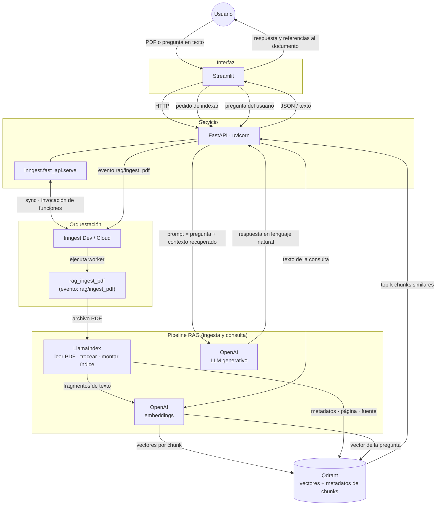

# rag-app

Aplicación en construcción para consultar documentos con **RAG** (Retrieval-Augmented Generation).

## ¿Qué es RAG?

**RAG** (*Retrieval-Augmented Generation*, generación aumentada por recuperación) es una forma de usar un modelo de lenguaje (LLM) respondiendo con apoyo en información **externa y actualizada**, en lugar de confiar solo en lo que el modelo “recuerda” del entrenamiento.

El flujo típico es:

1. **Ingesta**: se cargan fuentes (PDFs, textos, etc.), se fragmentan y se convierten en representaciones numéricas (*embeddings*).
2. **Almacenamiento**: esos fragmentos se guardan en una base vectorial para buscar por similitud semántica.
3. **Consulta**: la pregunta del usuario se embebe y se recuperan los trozos más relevantes.
4. **Generación**: el LLM arma la respuesta usando esos trozos como contexto, lo que reduce alucinaciones y permite citar el material indexado.

En este repositorio se implementa ese patrón como servicio (FastAPI, colas con Inngest, índices con LlamaIndex, vectores con Qdrant y una interfaz con Streamlit).

## Flujo

El stack del proyecto conecta la interfaz, el API, trabajos en segundo plano, el pipeline RAG y el almacén vectorial. El diagrama muestra **qué dato entra y sale** en cada paso y **cómo la respuesta vuelve al usuario**.

> **Estado del repo:** hoy `main.py` expone FastAPI y registra la función Inngest `rag_ingest_pdf` (disparada por el evento `rag/ingest_pdf`). El resto del recorrido (LlamaIndex → Qdrant, consultas desde Streamlit) es el diseño objetivo alineado con las dependencias del proyecto.

| Paso | Herramienta | Entrada | Salida |
|------|-------------|---------|--------|
| Interacción | Streamlit | Acciones del usuario | Llamadas HTTP al API; muestra la respuesta final |
| API | FastAPI | Peticiones de UI; callbacks de Inngest | Eventos hacia Inngest; orquestación de consulta RAG |
| Jobs | Inngest | Eventos (`rag/ingest_pdf`, etc.) | Ejecución durable de `rag_ingest_pdf` en el worker |
| Ingesta | LlamaIndex + OpenAI | PDF | Chunks de texto, embeddings, escritura en Qdrant |
| Consulta | OpenAI + Qdrant | Pregunta en texto | Fragmentos relevantes → respuesta del LLM fundamentada en ellos |
